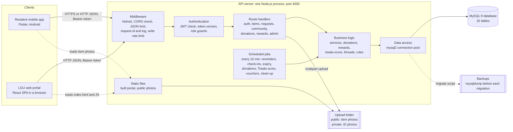
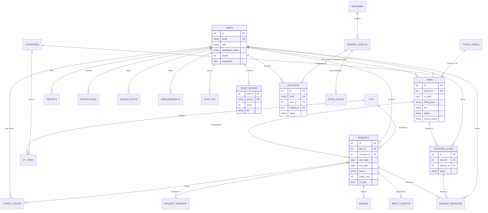
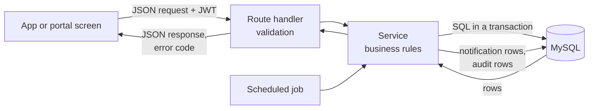
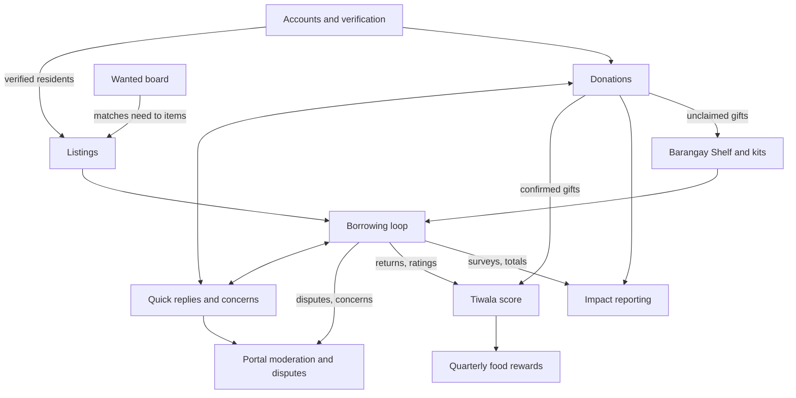
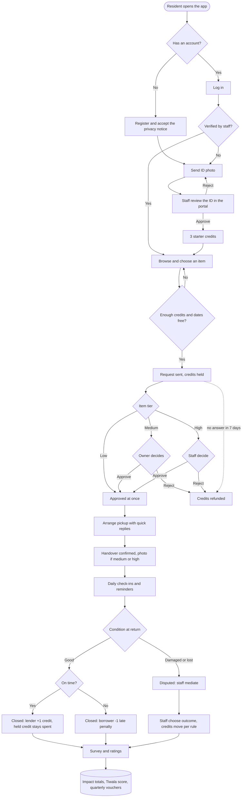
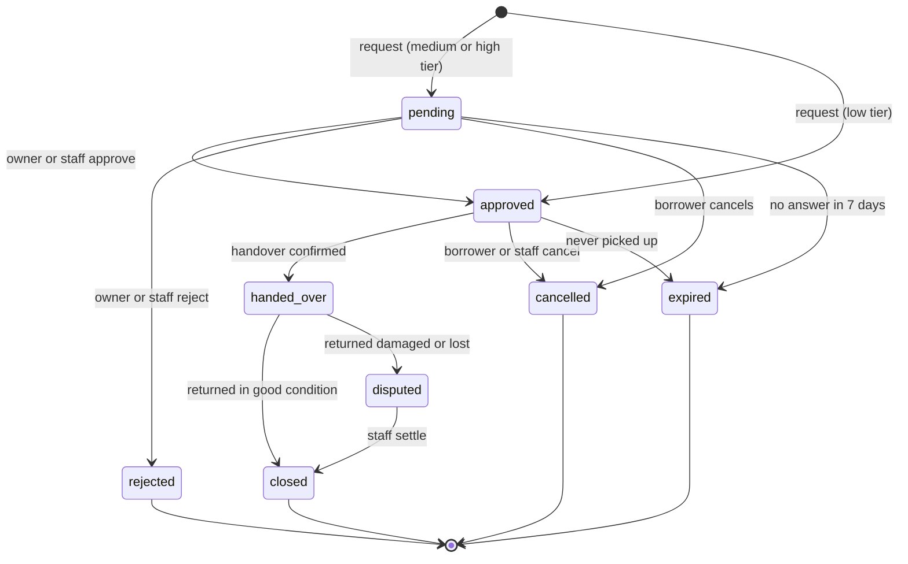

# Project Documentation and Technical Reference: Hiraman

*Hiraman: "Hiram muna, kapitbahay" ("Borrow first, neighbor"). A barangay sharing platform for lending, borrowing and giving everyday items, run under local government oversight.*

| | |
|---|---|
| Document version | 1.0, 24 October 2026 |
| Basis | The repository at commit `1564a03` (branch `main`): source code, configuration, database migrations `001` to `017`, the live database catalog (`information_schema`, read-only), tests and existing documentation in `docs/` |
| Audience | Academic evaluators, barangay and LGU stakeholders, and developers who maintain or extend the system |
| Method | Every project-specific statement was checked against the files named in Section 12.2. Statements that could not be verified are marked **Unverified** or **Requires confirmation**. Proposals are marked **Proposed** and are not described as existing. |

---

## Contents

1. Project Overview
2. Problem Statement and Significance
3. Relationship to the United Nations Sustainable Development Goals
4. System Architecture
5. Technology Stack and Technical Explanation
6. Database Architecture and Data Management
7. User Roles, Features, and Functional Relationships
8. End-to-End System Workflow
9. Security, Reliability, and Data Protection
10. Limitations and Future Improvements
11. Conclusion
12. References and Technical Evidence

---

## 1. Project Overview

### 1.1 Name and summary

The verified project name is **Hiraman**. The name appears in `README.md`, `server/package.json` (`hiraman-server`), `portal/package.json` (`hiraman-portal`) and `app/pubspec.yaml` (`hiraman`). Its tagline, *"Hiram muna, kapitbahay"*, appears in the app's splash and login screens.

Hiraman is a community item-sharing system for a **barangay**, the smallest administrative unit of local government in the Philippines. Verified residents lend and borrow everyday items (tools, party supplies, school and travel items), give items away, and receive food rewards for reliable lending. Barangay (Local Government Unit, LGU) staff verify residents, moderate listings, settle disputes, and run the community's own item collection, the **Barangay Shelf**.

The system has three parts that share one database:

| Part | Users | Technology | Folder |
|---|---|---|---|
| Resident mobile app | Residents | Flutter (Android; also runs in a web browser for testing) | `app/` |
| LGU web portal | Barangay staff and administrators | React single-page application | `portal/` |
| API server | Both of the above | Node.js with Express | `server/` |
| Database | (through the API only) | MySQL 8 | `database/`, migrations in `database/migrations/` |

### 1.2 Background and context

The repository states its purpose plainly: *"borrow what you need, lend what you don't use, and waste less together"*, built for SDG 12, target 12.5 (`README.md`). Many household items are used rarely; buying one per household multiplies purchases, storage and eventual waste. Lending within a neighborhood normally depends on personal trust. Hiraman adds barangay verification, a credit system and staff mediation so that neighbors who do not know each other well can share safely.

The project has been developed iteratively. `docs/CHANGELOG.md` and `docs/IMPROVEMENT_ROADMAP.md` record 34 numbered improvement batches. The most recent, "Hiraman 2.0" (batches 27 to 34), added the following, following a design specification:
- quick-reply messaging;
- origin labels;
- donations;
- an accessibility mode;
- decision effects;
- a trust score;
- food rewards.

### 1.3 Purpose and objectives

1. **Reduce unnecessary purchases** by making it easy to borrow an item a neighbor already owns.
2. **Keep sharing safe and fair** through identity verification, credits held while an item is out, photo evidence for valuable items, daily check-ins, and staff mediation of damage or loss.
3. **Give the barangay oversight** of residents, listings, transactions and disputes, with an audit trail.
4. **Encourage reuse and giving**: items can be marked "Repair and Reuse", given away for free, or handed to the Barangay Shelf.
5. **Recognize reliable lenders**: a trust score and quarterly food rewards (rice and vegetables from local producers, paid for by the LGU).
6. **Measure impact honestly**: completed loans and survey-based "purchases avoided", with waste reduction shown only as a labeled estimate range.

### 1.4 Intended users and stakeholders

| Stakeholder | Relationship to the system |
|---|---|
| Residents (lenders, borrowers, donors, receivers) | Use the mobile app; must be verified by the barangay before borrowing or lending |
| Barangay staff (`lgu_staff`) | Use the portal for day-to-day operations |
| Barangay administrators (`lgu_admin`) | Use the portal; also manage staff accounts, rule numbers, rewards and sensitive actions |
| Local producers (farmers, fisherfolk, gardens) | Supply reward goods paid for by the LGU; they are recorded in the system but **do not log in** (no supplier role exists) |
| The barangay's Data Protection Officer | Named in the privacy notice. The details are **not yet filled in** (Requires confirmation). |
| Seniors and persons with disabilities | Served by Simple mode and accessibility features |

### 1.5 Scope

**In scope (implemented):**
- resident registration and ID verification;
- item listings with risk tiers;
- borrowing with credits;
- donations;
- the Barangay Shelf and event kits;
- the Wanted board;
- quick-reply messaging and concerns;
- disputes and ratings;
- notifications;
- the trust score and food rewards;
- impact reporting;
- privacy rights (notice, data download, deletion request);
- portal administration;
- scheduled jobs, backups, migrations, automated tests, containers and continuous integration (CI).

**Out of scope or not present:**
- payments or money handling (by design);
- push notifications (only in-app notifications exist);
- SMS;
- a supplier login;
- public internet hosting with HTTPS;
- an iOS build.

### 1.6 Key capabilities at a glance

| Area | Verified capability |
|---|---|
| Trust and identity | ID photo verification by staff; the ID photo is deleted 7 days after the decision |
| Borrowing | Request, approve, hand over, return. Credits are held, refunded or rewarded. Late penalty, daily check-ins, extension, expiry, disputes. |
| Giving | Donations claimed first-come or chosen by the barangay (priority households first); both sides confirm the handover |
| Communication | Pre-written bilingual quick replies only; "Report a concern" goes to staff |
| Oversight | Portal dashboard, moderation, automatic flagging of possibly harmful listings, an audit log, editable rule numbers |
| Recognition | Badges, a Tiwala (trust) score, quarterly food-reward vouchers collected at the barangay hall |
| Inclusion | Filipino and English throughout, Simple mode, screen-reader labels, reduced-motion support |

### 1.7 Expected outcomes and practical value

The system is designed to produce:
- fewer duplicate purchases in the community;
- more items reused or kept in circulation;
- transparent, auditable barangay administration of shared resources;
- measurable indicators (Section 3.6) the barangay can report.

These outcomes are **expected**, not demonstrated. No field deployment data exists in the repository (Section 2.3).

---

## 2. Problem Statement and Significance

### 2.1 Basis of the problem statements

No stakeholder survey, interview record or baseline measurement is present in the repository. The problems below are therefore classified as:
- **Stated:** written as the project's aim in `README.md` or `docs/`.
- **Inferred:** deduced from the safeguards the system implements, each of which exists to prevent a specific failure.

None is claimed as independently verified in a particular barangay.

### 2.2 Problems and how the system addresses them

| # | Problem (classification) | Limitation of the informal practice | Affected | Implemented response | Expected benefit |
|---|---|---|---|---|---|
| P1 | **Rarely used items are bought by each household** (Stated: "borrow what you need, lend what you don't use, and waste less") | Sharing depends on knowing who owns what; there is no shared list | Residents, the community, the environment | Searchable listings by category and origin, event kits, Wanted board | Fewer purchases; more use per item |
| P2 | **Lending to strangers is risky** (Inferred from ID verification, tiers and credits) | No way to check identity, no deposit, no record of the agreement | Lenders | Barangay ID verification; credits held while an item is out; owner approval or staff handling by risk tier; photos at handover and return for medium and high tiers | Lenders can lend beyond their close circle |
| P3 | **Late returns, damage and loss cause conflict** (Inferred from check-ins, penalties and disputes) | Disagreements are settled privately, without evidence | Lenders, borrowers, barangay officials | Daily check-ins; a late penalty judged by the borrower's own "I returned it"; staff dispute settlement with four fixed outcomes | Fair, recorded resolution |
| P4 | **Barangay-owned equipment is lent without a system** (Inferred from the Barangay Shelf) | Paper logs or memory | Barangay staff | Barangay Shelf: free loans handled at the hall, per-item loan limits, a pause after repeated late returns | Accountable public property |
| P5 | **Usable items are thrown away** (Stated: Repair and Reuse, waste reduction) | No channel to pass items on | Residents, the environment | Donations ("free to take"); unclaimed gifts can go to the Shelf; a "Repair and Reuse" tag | Reuse instead of disposal |
| P6 | **Private chat between strangers enables harassment and scams** (Inferred from the 2.0 design decision recorded on 2026-10-23) | Open messaging apps cannot be moderated | Residents, especially vulnerable ones | Quick replies only between residents; a concern form only staff read; an automatic pause after repeated harassment concerns | Safer contact |
| P7 | **Seniors and persons with disabilities find apps hard** (Stated in the 2.0 design) | Small text, complex navigation | Seniors, PWDs | Simple mode, large touch targets, screen-reader labels, Filipino language | Wider participation |
| P8 | **Officials lack evidence of community impact** (Stated: "impact is counted honestly") | No data | Barangay, LGU | Impact page; an honest "purchases avoided" survey; a waste estimate labeled as a range | Evidence for reports and budgets |

### 2.3 Significance and differentiation

Hiraman's differentiators are visible in the implementation:
- **Government-backed trust.** Borrowing requires barangay verification; high-value items are handled by staff.
- **Credits instead of money.** No payments occur. A credit ledger records every change, and no balance goes below zero.
- **Fairness built into the rules.** Examples: lateness is judged by the borrower's own "I returned it" report, and a lender reward is limited to two per pair of residents per month.
- **Honest measurement.** Waste reduction is never reported as a measured quantity.

**Requires confirmation:** whether the barangay currently uses any other system, and baseline purchase or waste data. Without these, the benefits above remain projected.

---

## 3. Relationship to the United Nations Sustainable Development Goals

### 3.1 SDG 12 and its relevance

Sustainable Development Goal 12 is titled **"Responsible Consumption and Production"** (United Nations, n.d.-a; n.d.-b). The UN describes sustainable consumption and production as "key to protecting the livelihoods of current and future generations" (United Nations, n.d.-b).

Hiraman works at the consumption end: it aims to meet a household's need for an item without a new purchase. It does this through borrowing, giving and community stock. This places it within the "prevention" and "reuse" approaches named in target 12.5. The project's own `README.md` names SDG 12.5 as its primary goal.

### 3.2 Aligned SDG 12 targets

The target wording below is quoted from the official UN SDG page (United Nations, n.d.-a). "Alignment" means the system's features plausibly contribute at the scale of one barangay. The system does not achieve a global target.

| Target | Official wording (abridged where marked) | Strength of alignment | Rationale |
|---|---|---|---|
| **12.5** | "By 2030, substantially reduce waste generation through prevention, reduction, recycling and reuse" | **Primary** | Loans prevent purchases; donations and the Shelf extend the life of items (reuse); the Repair and Reuse tag encourages repaired items to stay in use |
| **12.2** | "By 2030, achieve the sustainable management and efficient use of natural resources" | Secondary | Each borrowed item serves several households, so fewer products, and the materials they are made from, are needed |
| **12.8** | "By 2030, ensure that people everywhere have the relevant information and awareness for sustainable development and lifestyles in harmony with nature" | Supporting | The Impact page and the thank-you board make sharing visible; the app explains the waste estimate honestly |
| 12.3 | "By 2030, halve per capita global food waste at the retail and consumer levels…" | **Not claimed** | Food cannot be donated through the system (`NOT_DONATABLE` in `server/src/rules.js`), and rewards involve food but not food-waste reduction |

### 3.3 How specific features contribute

| Feature (implemented) | Mechanism | Target |
|---|---|---|
| Listings and borrowing (`items`, `requests`) | A household's need is met by an existing item instead of a new purchase | 12.5 (prevention), 12.2 |
| Event kits (`kits`, `kit_items`) | One request borrows a whole set (for example party supplies) instead of buying it | 12.5 |
| Wanted board (`wanted_posts`) | Demand is matched to existing items before a purchase | 12.5 |
| Donations (`donation_claims`, `listing_type = 'donate'`) | Items no longer needed go to another household instead of disposal | 12.5 (reuse) |
| Barangay Shelf (`is_shelf = 1`) | Community-owned equipment is shared by all residents, and unclaimed gifts can join it | 12.5, 12.2 |
| Repair and Reuse tag (`repair_reuse`) | Repaired items are labeled and valued | 12.5 |
| Impact survey and estimate (`impact_surveys`, `GET /api/admin/impact`) | The borrower answers whether they would otherwise have bought the item; "yes" answers count as purchases avoided, and a weight estimate range is shown | 12.8 (information), monitoring of 12.5 |
| Trust score and food rewards (`trust_scores`, `vouchers`) | Reliable lending is rewarded, which sustains participation | Supports 12.5 indirectly |

### 3.4 From features to outcomes

The causal chain the system relies on is:

> A listed item → a loan or gift instead of a purchase → fewer new products bought → less material consumed and less waste produced.

The middle link is uncertain: a loan does not always replace a purchase. The system acknowledges this. Its impact calculation counts only borrowers who answered "yes, I would have bought or rented it". It adds "maybe" answers only to the upper bound of an estimate range, labeled *"ESTIMATE, not a measurement… One loan does not equal one product not made"* (`server/src/routes/admin.js`, impact route).

### 3.5 Beneficiaries

- **Residents:** save money; get access to items they could not afford.
- **Barangay:** gets better use of public equipment and evidence for planning.
- **Local producers:** are paid by the LGU for reward goods.
- **The wider environment:** fewer products and less waste (expected).

### 3.6 Indicators the barangay can track

The official SDG indicators for 12.5 (12.5.1, "National recycling rate, tons of material recycled") and 12.2 are **national** measures (United Nations, n.d.-a). A barangay system cannot report them directly. Local proxy indicators, all computable from existing tables, are proposed instead:

| Local indicator | Source in the system | Relates to |
|---|---|---|
| Completed loans per month | `requests` with `status = 'closed'` (portal Impact page) | 12.5 |
| Distinct items reused | `COUNT(DISTINCT item_id)` of closed loans (`items_reused`) | 12.5 |
| Purchases avoided (survey "yes") | `impact_surveys.would_have_bought = 'yes'` | 12.5 |
| Estimated weight not purchased (range, kg) | `waste_estimate_kg` (survey × average category weight) | 12.5, 12.2 |
| Items given away | `donation_claims.status = 'given'` | 12.5 (reuse) |
| Items added to the Barangay Shelf from donations | audit action `donation_to_shelf` | 12.5 |
| Active participants | verified residents with recent activity | 12.8 |

### 3.7 Other relevant SDGs (secondary)

- **SDG 16, targets 16.6 and 16.7:** "Develop effective, accountable and transparent institutions at all levels"; "Ensure responsive, inclusive, participatory and representative decision-making at all levels" (United Nations, n.d.-c). Relevant because staff decisions are audited and residents can raise concerns.
- **SDG 11, target 11.3:** "…capacity for participatory, integrated and sustainable human settlement planning and management…" (United Nations, n.d.-d). Relevant because of community-managed shared resources at the barangay level.
- **SDG 2, target 2.3:** "…double the agricultural productivity and incomes of small-scale food producers…" (United Nations, n.d.-e). The link is **weak**: rewards are bought from local producers by the LGU, which creates some local demand, but the scale is small and unmeasured.

---

## 4. System Architecture

### 4.1 Architectural approach

Hiraman follows a **client–server architecture with a layered, modular monolithic backend**:

- **Two clients:** the Flutter mobile app and the React web portal. Both use the same HTTP JSON API under `/api`.
- **One API server** (one Node.js process). It is organized in layers:
  - route handlers in `server/src/routes/`;
  - business-logic services: `services.js`, `donations.js`, `rewards.js`, `tiwala.js`, `threads.js`;
  - rules and configuration: `rules.js`, `phrases.js`, `settings.js`, `config.js`;
  - data access: `db.js`.
- **One relational database** (MySQL).
- **The same server process** also serves the built portal files and uploaded photos, and runs scheduled jobs (`jobs.js`).

No separate microservices, message queue, cache, cloud storage or third-party API exists.

### 4.2 System architecture diagram

*Note:* the connection is plain HTTP in the current setup. HTTPS is a planned deployment step (`docs/RELEASE.md`), not implemented.

### 4.3 Components

| Component | Responsibilities | Receives | Produces | Communicates with |
|---|---|---|---|---|
| **Mobile app** (`app/lib`) | Resident screens: browse, request, messages, donations, rewards, profile, privacy; offline-tolerant connection card | User input, JSON from the API | HTTP requests with a JWT; photo uploads | API only. It stores the token in encrypted device storage (`flutter_secure_storage`) and preferences in `shared_preferences` |
| **Web portal** (`portal/src`) | Staff and admin pages (15 pages under `portal/src/pages`) | Staff input, JSON | HTTP requests with a JWT | API only; built as static files and served by the API |
| **Middleware** (`server/src/app.js`) | Security headers (helmet), CORS allow-list, 200 KB JSON limit, request id and log line, per-person write rate limit | Every request | Rejections (429, 403) or a forwarded request | Routes |
| **Authentication** (`server/src/auth.js`) | Verify the JWT, load the user, check the token version (so logout ends all sessions), block suspended accounts; role guards `requireStaff`, `requireAdmin`, `requireApproved` | `Authorization: Bearer` header | `req.user`, or 401/403 | Database (`users`) |
| **Route handlers** (`server/src/routes/*.js`) | Validate input and call services; 132 operations described in `docs/openapi.json` | HTTP requests | JSON responses with stable error codes | Services, database |
| **Business logic** (`services.js`, `donations.js`, `rewards.js`, `tiwala.js`, `threads.js`, `phrases.js`, `kindwords.js`) | Request life cycle, credits, disputes, donations, quick replies, trust score, vouchers | Validated input | Database changes in transactions; notifications; audit rows | Database |
| **Rules and settings** (`rules.js`, `settings.js`) | Default rule numbers, banned and unkind words, screening; admin-editable numbers stored in `rule_settings` | Admin changes | The in-memory `RULES` object | All services |
| **Scheduled jobs** (`jobs.js`) | Run every 10 minutes; each job has its own interval and is recorded in `job_runs` | Time | Reminders, expiry, score calculation, voucher expiry, deletion of old data | Services, database |
| **Data access** (`db.js`) | Connection pool (default 10), helpers `q`, `one`, `withTx` (transactions), Philippine time on every session (`+08:00`) | SQL | Rows | MySQL |
| **File storage** (`uploads.js`) | Store photos after checking the real file type by its first bytes; public and private folders | Multipart uploads (5 MB maximum) | File paths | Local disk |
| **Database** | Persistent state | SQL | Rows | Data access only |

### 4.4 Deployment environment

Verified deployment options:
1. **Local development:** Node.js and MySQL on a Windows laptop (`docs/SETUP.md`). The phone connects over USB or Wi-Fi.
2. **Containers:** `docker-compose.yml` defines a `mysql:8.0` database and one `api` image (`Dockerfile`, Node 22). The image builds the portal and serves it from the API on port 4000. Data, uploads and backups live in named volumes.

**Not present:** public hosting, a domain, TLS certificates, a reverse proxy. These are listed as release steps in `docs/RELEASE.md`.

---

## 5. Technology Stack and Technical Explanation

Versions are taken from `package.json`, `pubspec.yaml`, `Dockerfile`, `docker-compose.yml` and `.github/workflows/ci.yml`. A caret (`^`) means "this version or a compatible newer one". The exact installed versions are in the lock files.

### 5.1 Inventory

| Category | Technology (verified version) | Role in Hiraman | Depends on it |
|---|---|---|---|
| Mobile front end | **Flutter / Dart** (SDK constraint `>=3.0.0 <4.0.0`; CI uses Flutter 3.35.4) | Resident app UI, Android build | All resident features |
| | `provider` ^6.1.1 | App-wide state (`AppState`: user, language, settings) | Every screen |
| | `http` ^1.2.0, `http_parser` ^4.0.2 | API calls and photo uploads | `core/api.dart` |
| | `flutter_secure_storage` ^10.3.4 | Encrypted storage of the login token | Login persistence |
| | `shared_preferences` ^2.2.2 | Language, server address, remembered filters | Settings |
| | `image_picker` ^1.0.7 | Take or choose photos (items, ID, handover) | Listings, verification |
| | `url_launcher` ^6.3.2 | Call and Text buttons, emergency call | Requests, concerns |
| | Nunito font (bundled in `assets/fonts`) | Typography | UI |
| Web front end | **React** ^19.3.1, **react-dom** ^19.3.1 | Portal UI | Portal |
| | **react-router-dom** ^7.18.4 | Portal page routing | Portal navigation |
| | **Vite** ^8.3.4 (+ `@vitejs/plugin-react`) | Development server and production build into `portal/dist` | Portal build |
| Back end | **Node.js** (`engines: >=22`; Docker image `node:22`) | Runtime for the API, jobs, scripts | Server |
| | **Express** ^5.3.0 | HTTP routing and middleware | All API routes |
| | **mysql2** ^3.24.6 | MySQL driver with connection pool and prepared parameters | Data access |
| | **multer** ^2.4.0 | Multipart photo uploads | `uploads.js` |
| | **dotenv** ^18.0.8 | Load settings from `server/.env` | `config.js` |
| Security | **jsonwebtoken** ^9.0.3 | Signed login tokens (14 days for residents, 12 hours for staff) | `auth.js` |
| | **bcryptjs** ^3.0.3 | Password hashing (cost 10) | Registration, login, resets |
| | **helmet** ^8.3.0 | HTTP security headers | `app.js` |
| | **cors** ^2.8.6 | Allowed browser origins (`CORS_ORIGIN`) | `app.js` |
| | **express-rate-limit** ^8.7.1 | Login attempts per network; writes per person | `auth.js`, `app.js` |
| Database | **MySQL 8.0** (`mysql:8.0` image; CI uses MySQL 8) | Relational storage, transactions, JSON columns | Everything |
| Testing | Node's built-in test runner (`node --test`) | 302 API and rule tests on a separate `hiraman_test` database | `server/test` |
| | `flutter_test` | Widget and unit tests, plus end-to-end tests against a real server | `app/test` |
| | **Playwright** ^1.64.1, **@axe-core/playwright** ^4.14.0 | Portal browser journeys and accessibility scans | `portal/e2e` |
| | Load test script (plain Node) | 50 to 200 simulated users | `server/scripts/load-test.js` |
| Code quality | ESLint ^10.13.0, Prettier ^3.9.10, `flutter_lints` 6.0.0 | Lint and formatting | All parts |
| Documentation | OpenAPI 3.1, generated by `server/scripts/openapi.js` | API description (`docs/openapi.json`, 132 operations) | Developers |
| Delivery | Docker, Docker Compose; **GitHub Actions** (jobs `server`, `app`, `containers`, `portal`, `e2e`) | Containers and automatic checks on every push | Releases |
| External APIs | **None** | No maps, SMS, payment or cloud services (a recorded decision: no paid services) | — |

### 5.2 How the technologies work together

1. The **Flutter app** and the **React portal** call the same **Express** API with JSON over HTTP and a **JWT** in the `Authorization` header. One API means one set of rules for both clients.
2. **Express** passes each request through **helmet**, **cors** and **express-rate-limit**, then through the authentication middleware, then to a route handler.
3. Route handlers call service functions. A service that changes several tables (for example "return an item") runs in a **MySQL transaction** through `mysql2`, with row locks, so credits and statuses never disagree.
4. **dotenv** supplies database credentials and the JWT secret from an environment file. In production the server refuses to start without a strong secret.
5. **Vite** compiles the portal into static files that **Express** serves from the same port. The portal and the API therefore share one origin, which needs no cross-origin configuration in production.
6. **Docker Compose** packages MySQL and the API together. **GitHub Actions** runs lint, unit and API tests on MySQL 8, the Flutter tests, a container health check, and the browser end-to-end and accessibility tests.

### 5.3 Suitability

- **Low cost.** All components are open source; there are no paid services, which matches a barangay budget (a recorded project decision).
- **One language across server and portal** (JavaScript), and **one cross-platform toolkit** (Flutter) for the app. This is a small team's maintenance load.
- **A relational database suits the domain.** Credits, loans and vouchers need transactions and foreign keys.
- **Unverified:** performance on low-end Android phones was assessed only with test frames and one physical device reported working by the user. Load-test results (95% of answers within 32 ms for 50 simulated users and 224 ms for 200, on a laptop) are recorded in `docs/QA_PLAN.md` and `docs/CHANGELOG.md`, not measured on production hardware.

---

## 6. Database Architecture and Data Management

### 6.1 Database management system and configuration

- **DBMS:** MySQL 8.0, InnoDB tables, character set `utf8mb4`.
- **Base schema:** `database/schema.sql`. **Changes:** 17 numbered migrations in `database/migrations/001…017`, each with an `-- up` and a `-- down` part. Applied migrations are recorded in `schema_migrations`.
- **Connection:** the `mysql2` pool in `server/src/db.js`, default 10 connections (`DB_POOL_SIZE`). Each session's time zone is set to Philippine time (`+08:00`), and dates are returned as text (`dateStrings`) to avoid time-zone shifts.
- **Test isolation:** tests use a separate `hiraman_test` database. The test helper refuses any database name that does not end in `_test`.
- Credentials come from environment variables and are not reproduced here.

### 6.2 Principal entities

The live schema has **32 tables**. The main ones:

| Group | Table | Purpose | Key fields |
|---|---|---|---|
| People | `users` | Residents, staff and admins | `id` PK; `email` unique; `role` (resident, lgu_staff, lgu_admin); `verification_status`; `credits`; privacy fields; pauses; `simple_mode`; `token_version` |
| | `puroks` | Neighborhood zones residents choose from | `name` unique |
| Items | `items` | Listings: residents' items and Barangay Shelf items | `owner_id` → users (NULL for Shelf items); `is_shelf`; `listing_type` (lend or donate); `tier`; `status`; `review_status`; `category_id`, `pickup_point_id` |
| | `categories`, `pickup_points` | Reference lists | — |
| | `kits`, `kit_items` | Event kits made of category lines | `kit_id`, `category_id` |
| Loans | `requests` | One borrow request through its whole life | `item_id`, `borrower_id`; dates; `status`; `credit_cost`; `credits_held`; handover and return photos and times; `on_time`; `dispute_outcome` |
| | `credit_ledger` | Every credit change | `user_id`, `request_id`, `amount`, `reason` |
| | `request_checkins` | The borrower's daily check-in | `request_id`, `day`, `answer` |
| | `ratings`, `impact_surveys` | Stars after a loan (`ratee_id` NULL = barangay service); "would you have bought it?" | — |
| Messaging | `request_messages` | Quick replies (`phrase_id` + `slot_value`) or staff text (`body`), on a request or a donation claim | `request_id` or `donation_claim_id`; `sender_id` |
| | `reports` | Reports, disputes and concerns | `reporter_id`, `target_type` and `target_id`, `about_user_id`, `status`, `outcome` |
| | `word_filter` | Unkind words added by admins | `word` unique |
| Community | `wanted_posts`, `announcements`, `notifications` | Wanted board, LGU announcements, in-app notices (`params` JSON) | `user_id`, `ref_id` |
| Donations | `donation_claims` | A claim on a free item | `item_id`, `claimer_id`, `status`, confirmations, `staff_delivery`, `chosen_by` |
| Rewards | `trust_scores` | Tiwala score per user per period | PK (`user_id`, `period`); `score`; `tier`; `parts` and `signals` JSON |
| | `suppliers`, `reward_catalog`, `stock_moves`, `vouchers` | Local producers, rewards and stock, the stock ledger, quarterly vouchers | `vouchers.code` unique; `catalog_id`; `status` |
| Administration | `audit_log`, `rule_settings`, `job_runs`, `schema_migrations` | Staff actions, admin-edited numbers, scheduled job results, migration history | — |

### 6.3 Entity-relationship diagram

The diagram shows the principal entities and their foreign keys, as read from `information_schema.KEY_COLUMN_USAGE`. Reference lists without foreign keys (`puroks`, `job_runs`, `schema_migrations`) are omitted, as are some secondary foreign keys to `users` (`reviewed_by`, `resolved_by`, `updated_by`, `added_by`, `released_by`, `given_by`, `chosen_by`).

### 6.4 How data is created, read, updated and deleted

| Operation | Example | Mechanism |
|---|---|---|
| Create | A resident sends a request | `createRequestTx` inserts into `requests`, deducts credits with a matching `credit_ledger` row, and writes a notification, all in one transaction |
| Read | Browse | `GET /api/items` with filters and paging; only `available` listings with review status `ok` are shown |
| Update | Return confirmed | `returnItem` locks the request row (`FOR UPDATE`), sets `closed` or `disputed`, moves credits, and writes notifications and the audit log |
| Delete | ID photo after 7 days; old free-text messages after a year; account deletion | Scheduled jobs and the admin delete route. Account deletion removes personal data but keeps anonymous loan records so totals stay correct (`deleted_at`) |

Most listings are not deleted but marked `removed`, which keeps the history.

### 6.5 Integrity and access control

- **Foreign keys** on all relations shown above; **unique keys** on email, voucher code and category slug.
- **Transactions with row locks** for credits, claims, vouchers and stock. Balances and stock never go below zero (checked in code before the update).
- **Every credit change** is a `credit_ledger` row; **every stock change** is a `stock_moves` row.
- **Validation** happens at the API before any database write: allowed values, date ranges, banned words, unkind words, file type.
- **Access:** clients never connect to MySQL; only the API does, through parameterized queries. Staff-only data (ID photos, the priority-household flag, Tiwala scores of others) is returned only by staff routes.

### 6.6 Data flow

---

## 7. User Roles, Features, and Functional Relationships

### 7.1 Roles and permissions

`users.role` is one of three values. Residents also have a verification status.

| Role or state | How it is obtained | Can | Cannot |
|---|---|---|---|
| **Resident, unverified or pending** | Self-registration in the app (with privacy consent) | Browse, read notices, send an ID photo (after ID consent), manage the profile, use privacy rights | Borrow, lend, claim or donate (`requireApproved`) |
| **Resident, approved** | Staff approve the ID; 3 starter credits | Everything residents do: list, borrow, give, claim, quick replies, concerns, ratings, check-ins, rewards | Type free text to other residents; see others' full names, phone numbers (except during an active loan), scores or flags |
| **Resident, suspended** | Staff action | Nothing: every request returns 403 `suspended` | — |
| **LGU staff** (`lgu_staff`) | Created by an admin | All portal operations: verification, moderation, transactions, disputes, donations, reward handout and stock, free-text messages, pauses | Change rule numbers, manage staff, delete accounts, add kind words, cancel vouchers, confirm collusion, issue vouchers manually |
| **LGU admin** (`lgu_admin`) | Created with `npm run create-admin` or by another admin | Everything staff can do, plus the restricted actions in the cell to the left | Edit the audit log (no route exists) |

**Not present:** a supplier or producer login, and a "guest" role.

### 7.2 Features by module

The tables summarize **purpose, user, trigger, input, processing and result**. All features listed are implemented and covered by tests (Section 12.2).

#### A. Accounts, verification and privacy

| Feature | User | Trigger and input | System action | Result |
|---|---|---|---|---|
| Register | Resident | Name, email, password (8+ characters), purok, privacy acceptance | Hash the password, create an unverified user, issue a JWT | Logged in, asked to verify |
| ID verification | Resident, then staff | ID consent, ID photo; staff press Approve or Reject (with a reason) | Store the photo privately; on approval add 3 credits (ledger) and notify | Verified resident; photo deleted 7 days after the decision |
| Login, logout, password | All | Email and password | Check bcrypt; lock the email after 5 failures in 15 minutes; logout raises `token_version` | Session started or ended everywhere |
| Privacy | Resident | View the notice, download "My data", request deletion | Versioned notice; full data export; an admin deletes | RA 10173 rights supported |

#### B. Listings and moderation

| Feature | User | Trigger and input | System action | Result |
|---|---|---|---|---|
| Share an item | Approved resident | Title, category, pickup point, condition, tier, photo; one-time lending terms | Refuse banned and unkind words; screen for disguised words, value words and new-account bursts; flagged listings are hidden | Listing visible, or held for staff review |
| Risk tiers | Owner | `low`, `medium` or `high` | Low: approved at once; medium: owner approves, photos required; high: staff approve and hand over at the hall | Proportionate control |
| Moderation | Staff | Hide, show, remove, edit; review the flagged queue | Audit; notify the owner | Unsafe listings removed |

#### C. Borrowing (the core loop)

| Feature | User | Trigger and input | System action | Result |
|---|---|---|---|---|
| Request | Borrower | Item, dates (within the item's maximum, default 14 days) | Check availability and booked dates; hold credits (1, 2 for high tier, 0 for Shelf) | `pending`, or `approved` for low tier |
| Decide | Owner or staff | Approve or reject | Refund on rejection; notify | `approved` or `rejected` |
| Handover | Owner or staff | Confirm, with a photo if medium or high | Start daily check-ins | `handed_over` |
| Check-in | Borrower | Still with me / I returned it / There's a problem | Alerts after 2 missed days | Lateness judged fairly |
| Return | Owner or staff | Condition: good, damaged or lost | Good: close, reward the lender +1 if on time (at most 2 per pair per month), penalize a late return −1; damaged or lost: dispute | `closed` or `disputed` |
| Dispute settlement | Staff | Outcome: fine, accident, borrower's fault, lost | Credits per fixed outcome table; never below 0 | Settled case |
| Extend, change dates, cancel, expiry | Owner or borrower, jobs | Days, new dates | Extend once (≤7 days); unanswered requests expire after 7 days with a refund | Flexible yet bounded |
| Rate and survey | Both | 1 to 5 stars; "would you have bought it?" | Store; feeds the impact page and the trust score | Reputation and impact data |

#### D. Barangay Shelf, kits and Wanted board

- **Barangay Shelf:** staff add LGU-owned items. Borrowing is free; handover happens at the hall. Staff can set a per-item loan limit. Two late returns in 90 days pause Shelf borrowing for 30 days.
- **Event kits:** one request books a free matching item for each line of a kit.
- **Wanted board:** a resident posts a need; another taps "I can lend this", which notifies the poster.

#### E. Messaging and concerns

- Quick replies (42 phrases, bilingual) are offered by situation and side. Each may carry one picked value (a date, a time, a place, a condition or a number). Limits: 10 per person per request per day, and the same phrase at most once every 10 minutes.
- Staff write free text.
- "Report a concern" goes to staff only. Safety and harassment concerns are urgent. Two harassment concerns about the same person within 30 days pause that person's messages.
- Unkind words (English and Filipino, including disguised spellings) are refused in the remaining typed fields.

#### F. Donations

- A gift is either **first to claim** (48-hour hold) or **barangay chooses** (residents ask for 3 days; staff choose, priority households first; optional delivery by staff).
- Both sides confirm the handover.
- Limits: 2 open claims and 4 per 30 days. No-shows and problem gifts lead to pauses that staff can lift. No regifting in a category within 30 days of receiving.
- Unclaimed after 14 days: the donor chooses to keep it listed, give it to the Shelf, or take it down. With no answer, it is taken down after 7 more days.

#### G. Trust score and food rewards

- **Tiwala score** (0 to 100, last 90 days): starts at 40, gains from qualifying loans, distinct borrowers, good returns, confirmed gifts, ratings and a clean record, and loses points for late returns, damage, loss, no-shows and removed listings.
- **Anti-abuse rules:**
  - pair and item caps;
  - same-day loans excluded;
  - new borrowers excluded for 30 days;
  - back-and-forth loops flagged;
  - a ring signal;
  - a staff check for Gold;
  - an admin collusion hold.
- **Tiers:** Bronze (50+), Silver (65+), Gold (80+), each with an activity requirement.
- **Vouchers:** quarterly, 1, 2 or 3 per tier (editable from 0 to 5). Each has a 6-digit code, is collected at the hall, and expires after 30 days. Stock is bought by the LGU and recorded with audit. A monthly report includes a 5% call-back list.

#### H. Notifications, impact and inclusion

- In-app notifications in the reader's language.
- Impact page: completed loans, items reused, purchases avoided, estimate range; an opt-in thank-you board.
- Simple mode: text 1.3× larger, four big buttons, no swiping or motion.
- Decision effects: short animations (at most 900 ms) with reduced-motion fallbacks.

#### I. Portal administration

The portal has 15 pages: Dashboard (urgent alerts), Verification, Residents, Listings, Barangay Shelf, Donations, Transactions (staff can step in on any request), Reports and disputes, Announcements, Impact, Tiwala score, Rewards, Rules (rule numbers, kind words, puroks, pickup points), Staff and audit log (admin only), and Login.

### 7.3 How the modules work together

Verification gates participation. Listings, the Shelf and gifts supply items. Borrowing and donations create the activity that the score rewards and the impact page measures. Messaging and moderation keep the activity safe. Together they serve the objectives in Section 1.3.

---

## 8. End-to-End System Workflow

This section follows the principal business process, **a resident borrowing an item from a neighbor**, from first contact to the final records. The donation and reward flows are summarized afterwards.

### 8.1 Step-by-step walkthrough

| # | Stage | Actor or component | Action | Data | Resulting state |
|---|---|---|---|---|---|
| 1 | Entry | Resident, app | Opens the app; the app looks for the server and shows onboarding the first time | Saved server address, language | Login screen |
| 2 | Registration | Resident → `POST /api/auth/register` | Enters details and accepts the privacy notice | Name, email, password (hashed with bcrypt), purok | `users` row, `unverified`; JWT returned |
| 3 | Verification | Resident → `POST /me/id-consent`, `/me/id-photo`; staff in the portal | Sends an ID photo; staff approve | Private ID photo; decision time | `approved`; 3 credits (ledger); notification; photo deleted 7 days later by a job |
| 4 | Access control | Middleware | Every later call checks the JWT, token version, suspension and role (`requireApproved` for borrowing) | Bearer token | 401, 403, or continue |
| 5 | Lender lists an item | Neighbor → `POST /api/items` | Title, category, tier, pickup point, photo; lending terms on the first listing | Validated text, screening flags | `items` row `available` (or `flagged`, hidden) |
| 6 | Search | Borrower → `GET /api/items` | Filters by origin, category, "free to take" | Query parameters | Paged list |
| 7 | Request | Borrower → `POST /api/requests` | Chooses dates within the item's limit | Item, dates | Credits held; `pending` (medium) or `approved` (low tier); owner notified |
| 8 | Decision | Owner (or staff for high tier) → `/approve` or `/reject` | Decides | Request id | `approved`, or `rejected` with a refund; borrower notified |
| 9 | Arrange | Both → quick replies | "Can we meet on…?" / "Yes, see you then." | Phrase id + slot | Messages; phone numbers visible after approval |
| 10 | Handover | Owner → `/handover` (photo if medium or high) | Confirms | Handover photo and time | `handed_over`; daily check-ins begin |
| 11 | During the loan | Borrower → `/checkin`; jobs | Daily check-in; due and overdue reminders; an alert after 2 missed days | Check-in answers | Notifications to the borrower, the owner and staff |
| 12 | Return | Owner → `/return` | Records the condition | `good`, `damaged` or `lost`; photo | Good: `closed`, lender +1 if on time and under the pair cap, borrower −1 if late. Otherwise: `disputed` and a report |
| 13 | Dispute (branch) | Staff in the portal → `PATCH /admin/reports/:id` | Chooses an outcome | `fine`, `accident`, `borrower_fault` or `lost` | Credits move per the table; request settled |
| 14 | After the loan | Borrower, both | Survey ("would you have bought it?"), ratings | Answers, stars | Impact data; reputation |
| 15 | Records and reports | Jobs, portal | Nightly Tiwala score; quarterly vouchers; Impact page; audit log | Aggregates | Staff reports; resident rewards |

### 8.2 Overall workflow flowchart

### 8.3 Request status model

### 8.4 Donation and reward flows (summary)

**Donation:** list as "Give it away", then one of two paths:
- *First to claim:* a resident claims and gets a 48-hour hold, then a quick-reply pickup, then "I gave it" and "I got it". The result is `given`.
- *Barangay chooses:* residents ask for 3 days, staff choose (priority households first, optional delivery), then the same handover.

Exceptions: a release, cancel or no-show offers the item again; a problem goes to staff. Unclaimed after 14 days, the donor keeps it listed, gives it to the Shelf, or takes it down.

**Reward:**
1. Nightly score calculation, with a quarter snapshot on the first day of each quarter.
2. Vouchers issued by tier (Gold is held for a staff check).
3. The resident chooses rice or vegetables, which reserves stock.
4. The resident shows the 6-digit code at the hall.
5. Staff hand it out (status `given`), with a notification and an audit row.

Unused vouchers expire after 30 days and the reserved stock returns.

---

## 9. Security, Reliability, and Data Protection

Assessment levels:
- **Verified:** implemented, and covered by tests where noted.
- **Partial:** implemented with known limits.
- **Not established:** missing.

| Area | Safeguard | Status | Evidence |
|---|---|---|---|
| Authentication | JWT with an expiry (residents 14 days, renewed daily while in use; staff 12 hours); bcrypt hashes; `token_version` ends all sessions on logout or password change | Verified | `server/src/auth.js`; `accounts.test.js` |
| Brute force | 5 wrong passwords per email in 15 minutes locks that email for 15 minutes; 60 login tries per network in 15 minutes | Verified, Partial | The lockout is in server memory and resets on restart |
| Authorization | Role guards; object checks (only the borrower or owner sees a request; claim and voucher ownership); approved-only actions | Verified | `staff-control.test.js`, `donations.test.js`, `rewards.test.js` |
| Abuse limits | Writes per person (default 300 per window); messages and reports per day | Verified | `app.js`, `threads.js` |
| Input validation | Allowed values, dates, lengths; 200 KB JSON limit; banned, disguised and unkind words | Verified | `rules.js`, `kindwords.js` |
| Uploads | Real file type checked from the first bytes; 5 MB limit; ID photos private, staff route only; unused uploads deleted | Verified | `uploads.js`, `uploads.test.js` |
| Injection | Parameterized SQL through `mysql2`; dynamic column names only from fixed lists | Verified by inspection | `routes/*.js` |
| Spreadsheet injection | Export cells beginning with `= + - @` are neutralized | Verified | `api-basics.test.js` |
| Headers and CORS | helmet; CORS allow-list (empty = this server and localhost only) | Partial | The development `.env` currently sets `CORS_ORIGIN=*`; it must be restricted before release |
| Transport security | HTTPS | **Not established** | Plain HTTP; Android allows cleartext traffic for local servers |
| Secrets | The server refuses to start in production with a weak `JWT_SECRET`; `.env` is not committed | Verified | `config.js` |
| Data integrity | Transactions, row locks, foreign keys, credit and stock ledgers, balances never negative | Verified | `services.js`, `rewards.js` |
| Audit | Staff and admin actions written to `audit_log`; no edit route | Verified | `audit_log` |
| Errors | Central error handler; stable error codes; a request id shown to users; logs without query strings or personal data | Verified | `errors.js`, `logging.test.js` |
| Reliability | Health check (`/api/health`, with a database probe); scheduled jobs isolated from each other; client timeouts and retry | Verified | `jobs.test.js` |
| Backup and recovery | `npm run backup` / `restore` (mysqldump); an automatic backup before every migration; each migration has an undo | Verified, Partial | No automatic *scheduled* backup or off-site copy |
| Privacy (RA 10173) | Versioned notice and consent; ID consent; ID photos deleted 7 days after the decision; "My data" export; deletion request; first names only shown to neighbors; phone numbers only during a loan; the priority flag is staff-only with no reason stored | Verified, Partial | The DPO contact is blank; the notice needs a legal review |
| Mobile storage | Token in `flutter_secure_storage`; Android backup of app data disabled | Verified | `AndroidManifest.xml` |
| Release signing | A release key read from a git-ignored `key.properties` | Partial | The key is not yet created (`docs/RELEASE.md`) |

The OWASP Top 10 (OWASP Foundation, 2025) was used as the reference list of common web risks. No external penetration test has been performed, so the system should not be described as "secure" beyond the evidence above.

---

## 10. Limitations and Future Improvements

### 10.1 Current functional limitations

- No push or SMS notifications. Residents see notices only when they open the app (no paid services, by decision).
- No supplier login. Producers are records only, and handouts happen at the barangay hall.
- The 2.0 design's Phase 2 and 3 items are **not implemented**:
  - a handover code;
  - guided condition photos for all tiers;
  - calamity mode;
  - wishlist matching;
  - an analytics dashboard;
  - links to household records;
  - offline mode;
  - tool-library days;
  - seasonal drives;
  - dispute appeals.
- Silver's "first pick for 24 hours" and the error "shake" effect from the specification were not built.
- iOS is not built or tested.

### 10.2 Technical and architectural limitations

- A single server process. The login lockout and rate-limit counters live in memory, so they reset on restart and would not be shared across several servers.
- Photos are stored on local disk, with no off-site copy.
- Scheduled jobs run inside the API process. If it stops, reminders and expiries wait until it restarts (the jobs catch up because each records its last run).
- Some business data is stored as JSON (`trust_scores.parts` and `signals`, `notifications.params`), which is less query-friendly.

### 10.3 Operational and usability limitations

- Not deployed for real residents: no hosting, domain or HTTPS.
- Requires a smartphone; residents without one rely on staff at the hall.
- Field data on actual use, waste avoided or satisfaction does not exist yet.
- Only the 2.0 features were tried on a real phone by the developer (reported working on 24 October 2026). No usability study with residents or seniors has been recorded.

### 10.4 Security and data-management concerns

- HTTPS is missing, and `CORS_ORIGIN` is open in the development configuration.
- The DPO details are missing and the privacy notice has had no legal review.
- No scheduled or off-site backups.
- No external security assessment.
- Reward stock involves public funds. The audit and call-back list exist, but the procedure for reconciling them with LGU purchasing records must be defined by the barangay (**Requires confirmation**).

### 10.5 Recommended future enhancements (Proposed)

| Proposal | Problem addressed | Expected benefit | Relevance |
|---|---|---|---|
| Hosting behind a reverse proxy with HTTPS | Credentials readable on shared networks | Safe real-world use | Prerequisite for deployment |
| Scheduled off-site database and upload backups | Loss of data on hardware failure | Recoverability | Reliability |
| Persistent rate-limit and lockout storage | Counters reset on restart | Consistent protection | Security |
| A free handover code (6 digits) at handover and return | Confirmations can be tapped without meeting | Stronger proof of exchange; fairer scores | Trust; score integrity |
| Guided condition photos for all tiers | Low-tier disputes lack evidence | Fairer dispute outcomes | Fairness |
| Calamity mode | Essential items needed quickly after typhoons | Faster distribution of Shelf items | SDG 11 resilience |
| Wishlist matching | Wanted posts need manual browsing | More matches before purchases | SDG 12.5 |
| Analytics dashboard with exportable indicators (Section 3.6) | Officials need periodic SDG reporting | Evidence for budgets | SDG 12.8, 16.6 |
| A field pilot with baseline and follow-up surveys | Impact is currently projected | Measured outcomes | Academic validity |

---

## 11. Conclusion

Hiraman addresses a common household inefficiency: buying items that are needed only occasionally. It answers the reasons neighbors seldom share: lack of trust, fear of loss, no record, and no easy way to find what others own. Its answer is a barangay-governed sharing system:
- identity verification gives every participant an accountable identity;
- credits and risk tiers make lending proportionate and fair;
- quick replies and staff mediation keep contact safe;
- donations, the Barangay Shelf and the Repair and Reuse tag keep usable things in circulation.

The trust score and food rewards, bought by the LGU from local producers, recognize reliable lenders without introducing money between residents.

Technically, the system is a client–server design: a Flutter app and a React portal share one Express API backed by MySQL. The rules live in one place on the server, and every credit, stock and staff action is recorded. Transactions, role checks, privacy measures under RA 10173, more than 300 automated API tests, browser and accessibility tests, and containerized deployment support its correctness and maintainability.

Its contribution to **SDG 12, target 12.5**, is logical and measurable at the local level: each loan, gift or Shelf use is an opportunity to prevent a purchase. The system counts only reported avoided purchases and labels its waste figures as estimates. Contributions to 12.2 and 12.8 follow from the same mechanisms.

The main gaps are deployment-related (hosting, HTTPS, backups, legal review) and evidential (no field data yet). The most valuable next steps are a secure deployment and a pilot that measures real outcomes.

---

## 12. References and Technical Evidence

### 12.1 External references

- National Privacy Commission. (2012). *Republic Act No. 10173: Data Privacy Act of 2012*. https://privacy.gov.ph/wp-content/uploads/2017/03/DPA-of-2012.pdf
- OWASP Foundation. (2025). *OWASP Top 10*. https://owasp.org/www-project-top-ten/
- United Nations. (n.d.-a). *Goal 12: Ensure sustainable consumption and production patterns — targets and indicators*. Department of Economic and Social Affairs. https://sdgs.un.org/goals/goal12
- United Nations. (n.d.-b). *Goal 12: Responsible consumption and production*. https://www.un.org/sustainabledevelopment/sustainable-consumption-production/
- United Nations. (n.d.-c). *Goal 16: Peace, justice and strong institutions — targets*. https://sdgs.un.org/goals/goal16
- United Nations. (n.d.-d). *Goal 11: Sustainable cities and communities — targets*. https://sdgs.un.org/goals/goal11
- United Nations. (n.d.-e). *Goal 2: Zero hunger — targets*. https://sdgs.un.org/goals/goal2
- Technology documentation (for readers):
  - Express: https://expressjs.com/
  - Flutter: https://docs.flutter.dev/
  - React: https://react.dev/
  - MySQL 8.0 Reference Manual: https://dev.mysql.com/doc/refman/8.0/en/
  - JSON Web Token, RFC 7519: https://www.rfc-editor.org/rfc/rfc7519
  - Web Content Accessibility Guidelines 2.2: https://www.w3.org/TR/WCAG22/

The SDG target wording was retrieved from the UN pages above on 24 October 2026.

### 12.2 Project evidence

| Claim area | Files |
|---|---|
| Name, purpose, demo accounts | `README.md`, `docs/INSTRUCTOR_SUMMARY.md` |
| Architecture and middleware | `server/src/app.js`, `server/src/index.js`, `server/src/auth.js`, `server/src/db.js` |
| Business rules and numbers | `server/src/rules.js`, `server/src/settings.js`, `server/src/services.js` |
| Messaging | `server/src/phrases.js`, `server/src/threads.js`, `server/src/kindwords.js` |
| Donations, score, rewards | `server/src/donations.js`, `server/src/tiwala.js`, `server/src/rewards.js` |
| Jobs | `server/src/jobs.js` |
| Privacy notice | `server/src/privacy.js` |
| API description | `docs/openapi.json` (132 operations), `server/scripts/api-catalog.js` |
| Database | `database/schema.sql`, `database/migrations/001`–`017`; live catalog read on 24 Oct 2026 (32 tables) |
| Technology versions | `server/package.json`, `portal/package.json`, `app/pubspec.yaml`, `Dockerfile`, `docker-compose.yml`, `.github/workflows/ci.yml` |
| Tests | `server/test/*.test.js` (302 passing), `app/test/` (34 passing + 4 end-to-end journeys), `portal/e2e/` (8 passing, including accessibility), as of the last run on 24 Oct 2026 |
| Decisions and history | `docs/IMPROVEMENT_ROADMAP.md`, `docs/CHANGELOG.md`, `docs/RELEASE.md`, `docs/QA_PLAN.md` |
| 2.0 design | "Hiraman 2.0 Design Spec" (Claude Docs, shared by the project owner) |

### 12.3 Items requiring confirmation

1. The specific barangay and LGU that will operate the system, and their current practice and baseline data.
2. The Data Protection Officer's details and a legal review of the privacy notice.
3. The yearly reward budget and the LGU purchasing and reconciliation procedure.
4. The hosting environment and the HTTPS setup.
5. Whether the latest GitHub Actions run passed (not observed from the development machine).
